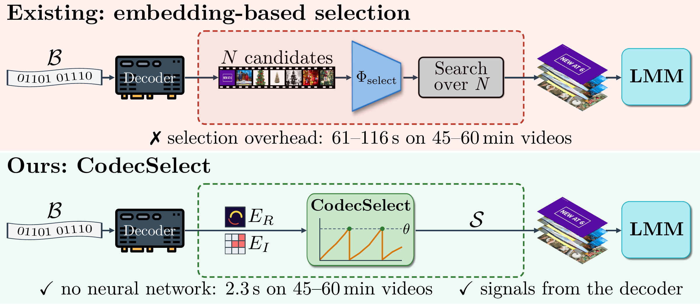

# Codec-guided Selection Cheaply Removes Redundant Frames for Video LMMs

[Luca Zanella](https://lucazanella.github.io/), [Muhammad Ferjad Naeem](https://ferjad.github.io/), [Yongqin Xian](https://xianyongqin.github.io/), [Elisa Ricci](https://eliricci.eu/), [Massimiliano Mancini](https://mancinimassimiliano.github.io/), [Federico Tombari](https://federicotombari.github.io/), [Alessio Tonioni](https://alessiotonioni.github.io/)  

  

 

> **Abstract:** *For temporal reasoning over videos, Large Multimodal Models (LMMs) commonly rely on dense sampling at a fixed frame rate. Consecutive frames are often nearly identical, yet each sampled frame adds visual tokens that the LMM must encode and attend to. While embedding-based selectors drop these redundant frames, they must first process every candidate frame with a vision backbone, reducing or even undoing the time saved in the LMM. In this work, we posit that selection should take place before the LMM or any other model processes the video, i.e., at decoding time. We propose CodecSelect, a training-free method that exploits, during decoding, two signals already stored in the compressed bitstream: residual energy and intra-block ratio. Used as proxies for visual novelty, they mark the changes the encoder already found, so CodecSelect keeps more frames where the content changes and fewer where it is static. This costs under 1.5% of the total time per query. Across four LMMs and three temporal reasoning benchmarks, CodecSelect matches the accuracy of dense sampling while keeping 64% of the frames and reducing latency per query by 36%. On two long-video benchmarks, where embedding-based selectors are slower than dense sampling, it answers 14 to 16% faster with comparable accuracy.*

# Code

Code coming soon.
